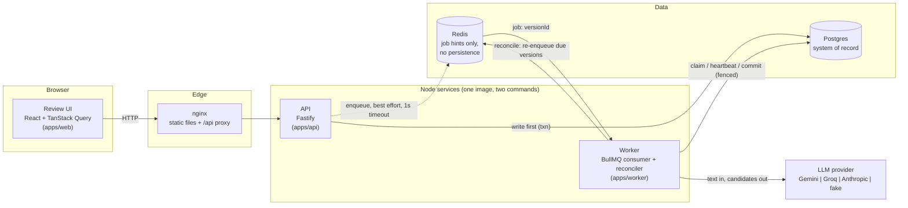
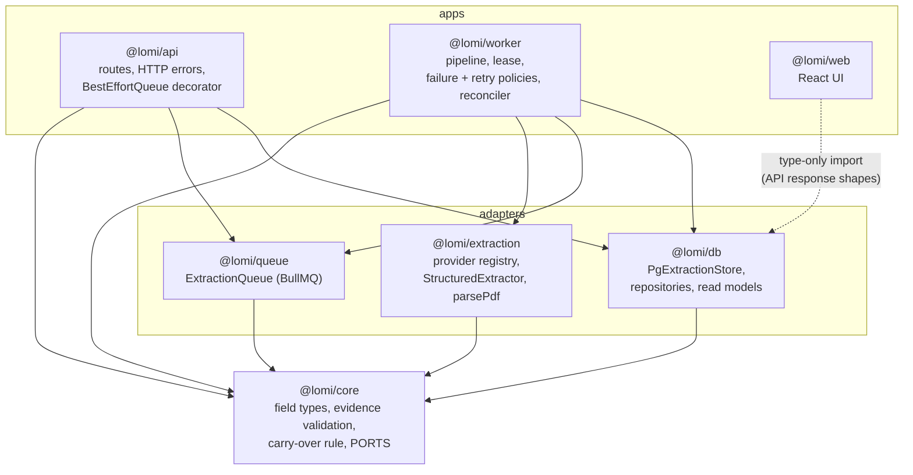
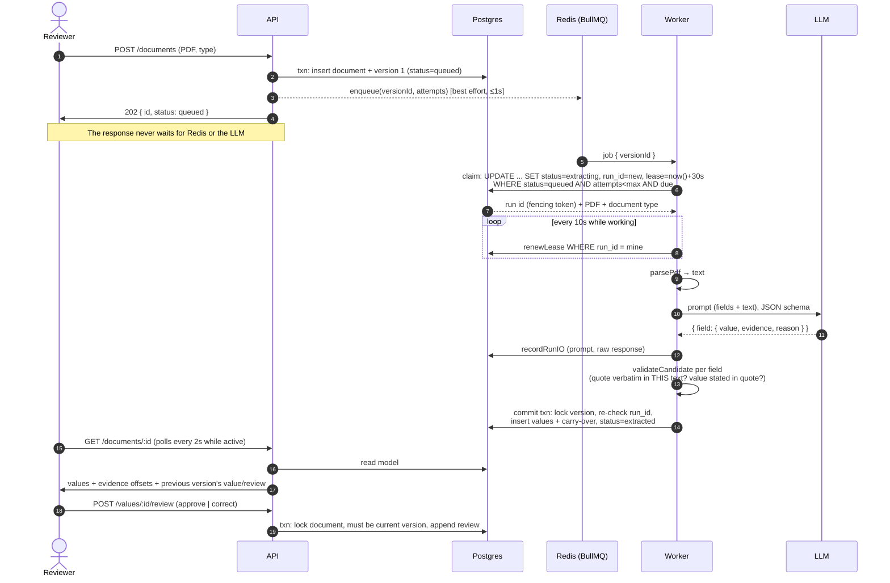
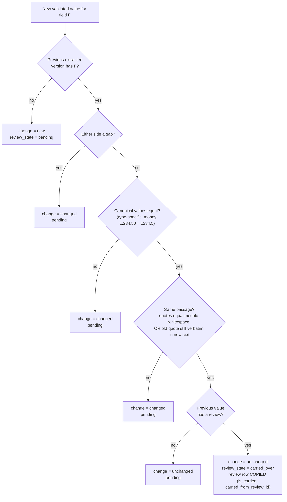
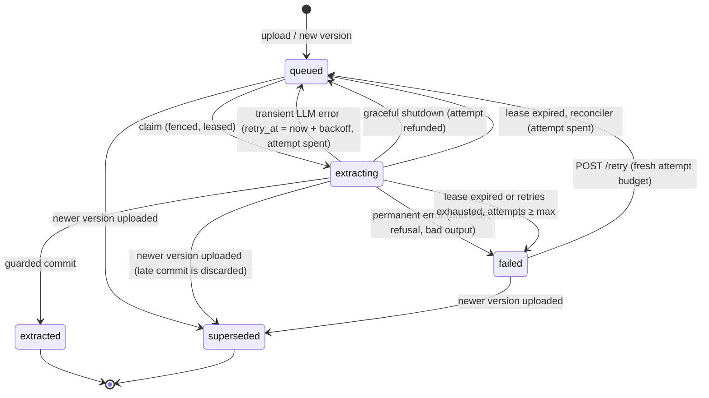
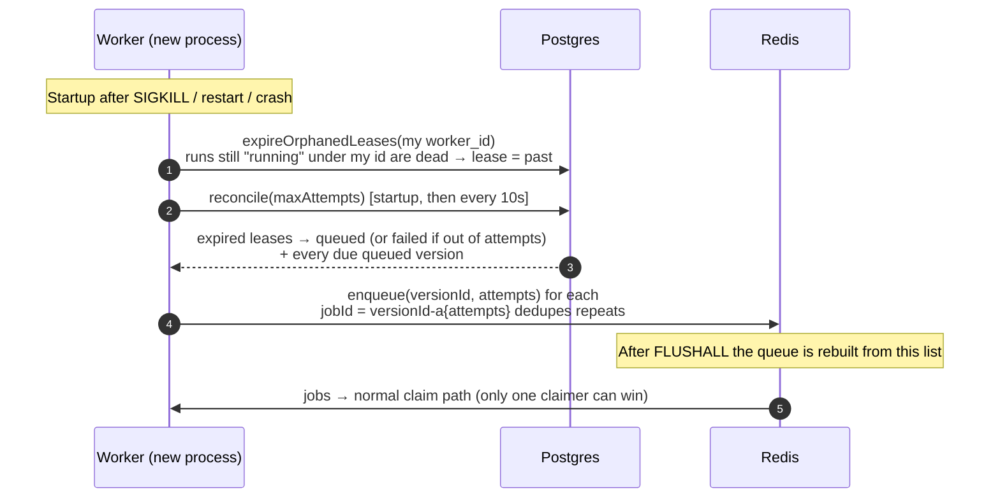
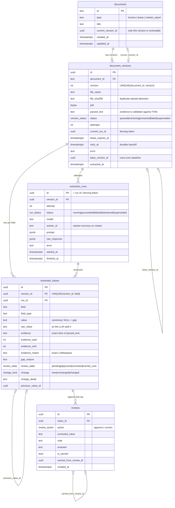

# Architecture

This document describes how the system is built: the components and how they depend on each other, how data flows through them, the data model, and the design principles behind the code layout. The README covers how to run the system and the product decisions. TESTING.md covers how all of this is verified.

All diagrams are Mermaid, so GitHub renders them inline.

---

## 1. The system in one paragraph

A reviewer uploads a PDF. The API stores it in **Postgres** as a new document version with status `queued` and returns `202` immediately. It then nudges **Redis/BullMQ**, on a best-effort basis, to say that the version needs work. A **worker** claims the version in Postgres with a fenced, leased claim. It parses the PDF, asks an **LLM** for candidate values, and keeps a candidate only if its quoted evidence appears verbatim in this version's text and states the value. It then commits all values in one guarded transaction. That transaction also decides which earlier human reviews carry over to the new version. A **React** UI polls the API while work is in flight and lets the reviewer approve or correct each value next to its highlighted evidence.

**Postgres is the source of truth. Redis is disposable.** Every state transition lives in Postgres, and a reconciler can rebuild the whole queue from it. That is why a Redis `FLUSHALL`, a `SIGKILL` or a `docker compose restart` loses nothing.

---

## 2. Components



| Component | Responsibility | Does **not** |
|---|---|---|
| **API** (`apps/api`) | Accept uploads and reviews, serve read models, nudge the queue | Call the LLM, or depend on Redis being up |
| **Worker** (`apps/worker`) | Claim → parse → extract → validate → commit; recover lost work | Trust Redis for state; retry inside BullMQ |
| **Postgres** | Versions, runs, values, reviews, leases, retry times | n/a |
| **Redis/BullMQ** | Wake a worker quickly when there is work | Hold anything that cannot be rebuilt |
| **LLM** | Propose candidate values with quotes | Decide what is stored (validation does that) |
| **Web UI** (`apps/web`) | Review queue, evidence highlighting, version history, run log | Hold state beyond the server's |

### 2.1 Package dependency graph (Ports & Adapters)

The code is a Turborepo monorepo. Arrows point from a package to the package it depends on. **`@lomi/core` depends on nothing**: it holds the domain rules and the *ports*, which are the interfaces the application needs. The other packages are *adapters* that implement those ports (Postgres, BullMQ, LLM SDKs) or *applications* that wire the adapters together.



The ports, all in `packages/core/src/ports.ts`:

| Port | Used by | Implemented by |
|---|---|---|
| `Extractor` | worker pipeline | `GeminiExtractor`, `GroqExtractor`, `AnthropicExtractor`, `FakeExtractor`, `ScriptedExtractor` (tests) |
| `JobQueue` | API, reconciler | `ExtractionQueue` (BullMQ), `BestEffortQueue` (decorator), `RecordingQueue` (tests) |
| `ExtractionStore` | worker pipeline | `PgExtractionStore` |
| `RecoveryStore` | reconciler, worker startup | `PgExtractionStore` |

The worker's pipeline imports no Postgres, BullMQ or LLM SDK code. It sees four small interfaces. The worker's `main.ts` is the **composition root**: it is the only file that knows which concrete classes are used.

### 2.2 Inside each package

```
packages/core/src
  field-types.ts      Strategy registry: string | date | money | number | percent
  fields.ts           Document types → field definitions (pure data)
  evidence.ts         findEvidence + validateCandidate (the hallucination defence)
  carryover.ts        compareForCarryOver (the "unchanged" rule)
  status.ts           Version statuses, review states (also feed the Postgres enums)
  ports.ts            Extractor, JobQueue, ExtractionStore, RecoveryStore
  text.ts             Whitespace / number / date helpers (internal)

packages/db/src
  schema.ts           Drizzle tables + enums
  repositories/
    ingest.ts             createDocument, addVersion (supersede, duplicate no-op), retryCurrentVersion
    extraction-store.ts   PgExtractionStore: claim, renewLease, commit, markFailed,
                          scheduleRetry, releaseForShutdown, expireOrphanedLeases, reconcile
    carry-over.ts         baseline lookup + insert values with carried reviews (inside commit)
    reviews.ts            reviewValue (append-only)
    queries.ts            read models for the UI (listDocuments, getDocument, ...)
    shared.ts             lockDocument, latestReviews, SQL helpers
    errors.ts, types.ts

packages/extraction/src
  structured-extractor.ts  Template Method base for every structured-output provider
  providers/{gemini,groq,anthropic,fake}.ts   one file per provider + its ProviderDefinition
  registry.ts         registerProvider / createExtractor (Registry + Factory)
  prompt.ts           one prompt + schema for all providers
  errors.ts           LlmError, HTTP status → retryable mapping
  pdf.ts              parsePdf
  testing.ts          ScriptedExtractor (exported as @lomi/extraction/testing)

apps/worker/src
  pipeline.ts         processVersion: the use case, written against ports only
  lease.ts            heartbeat loop (holdLease)
  failure-policy.ts   classifyFailure: error → lost_ownership | release | retry | fail (pure)
  retry-policy.ts     retryDelayMs: backoff with provider hint and cap (pure)
  reconciler.ts       reconcileOnce
  config.ts           env → WorkerConfig
  main.ts             composition root, shutdown handling

apps/api/src
  app.ts              buildApp: plugins, error handler, routes
  routes/documents.ts, routes/values.ts
  http/upload.ts, http/errors.ts
  best-effort-queue.ts  Decorator: JobQueue that never throws and never blocks > 1s
  main.ts, seed.ts
```

---

## 3. Data flow

### 3.1 Upload → extraction → review (happy path)



### 3.2 Re-extraction with carry-over

When version N+1 is extracted, the commit transaction compares each new value with the same field in the **newest extracted version older than N+1**. It reads the baseline inside the commit transaction, so reviews made while the LLM call was running are taken into account.



The rule errs toward "changed". A false "changed" costs a reviewer a few seconds. A false "unchanged" silently trusts a value nobody looked at.

### 3.3 Version state machine



### 3.4 Recovery flows



| Event | What saves us |
|---|---|
| Upload while Redis is down | Version is already `queued` in Postgres; the reconciler enqueues it within 10s |
| `docker compose restart` | `SIGTERM` → in-flight runs `releaseForShutdown` (attempt refunded); startup reconcile re-enqueues |
| Worker `SIGKILL` | Lease stops being renewed. On restart, `expireOrphanedLeases` by `worker_id` makes recovery immediate; other workers pick it up when the lease expires |
| Redis `FLUSHALL` | Reconciler re-enqueues every due `queued` version from Postgres |
| Duplicate job / two workers | Conditional `claim` lets exactly one win; `UNIQUE(version_id, field)` blocks double values |
| Zombie worker returns late | Its run id no longer matches, so commit / fail / heartbeat are no-ops |
| New version mid-extraction | Old version → `superseded` in the upload txn. Heartbeat sees it and aborts the LLM call; a late commit is discarded |
| LLM rate limit | `scheduleRetry` writes `retry_at` in Postgres; the claim ignores the version until then |
| Poison document | Attempts are counted in Postgres; after `MAX_ATTEMPTS` (3) the version is `failed`, visibly |

---

## 4. Data model (ERD)



Key invariants:

- **`UNIQUE(version_id, field)`** makes extraction idempotent. However many runs race, a version holds at most one value per field.
- **The LLM's value is never overwritten.** A correction is a new `reviews` row, and the latest row is the current decision.
- **Carried reviews are copies** that point to the original review, so the old version's history is never mutated.
- **`current_run_id` + `status = 'extracting'`** guard every write after a claim (fencing).
- **The PDF and its parsed text are stored per version**, so version N is always shown and checked against its own text.

---

## 5. Design principles and patterns

### 5.1 SOLID, concretely

| Principle | Where it shows |
|---|---|
| **S**ingle responsibility | The worker is split by reason to change. `pipeline.ts` is the use case, `lease.ts` keeps the heartbeat, `failure-policy.ts` decides what an error means, `retry-policy.ts` does the backoff arithmetic, and `reconciler.ts` handles recovery. The db layer is split into ingest, the extraction lifecycle, carry-over, reviews and read queries. The API is split into routes, upload parsing, error mapping and the queue decorator. |
| **O**pen/closed | **New field type**: add one `FieldTypeHandler` to `FIELD_TYPES`. Validation, carry-over, prompt hints and review normalisation pick it up. **New document type**: one entry in `FIELDS`. **New LLM provider**: one file under `providers/` with a `ProviderDefinition`, plus one `registerProvider` call. None of these touch the pipeline, the evidence check or the API. |
| **L**iskov substitution | Every `Extractor` (real, fake, scripted) and every `JobQueue` (BullMQ, best-effort decorator, recording test queue) is interchangeable. The integration tests run the real pipeline with `ScriptedExtractor` and `RecordingQueue`. |
| **I**nterface segregation | `ExtractionStore` (the worker's transitions) and `RecoveryStore` (the reconciler's sweep) are separate ports. `holdLease` only asks for `Pick<ExtractionStore, "renewLease">`. The API only sees `JobQueue`, never BullMQ. |
| **D**ependency inversion | `@lomi/core` owns the interfaces and the adapters depend on it, never the reverse. The worker's `main.ts` and the API's `main.ts` are the only composition roots. |

### 5.2 Design patterns used

| Pattern | Where | Why |
|---|---|---|
| **Ports & Adapters (Hexagonal)** | `core/ports.ts`; adapters in `db`, `queue`, `extraction` | The business flow can be tested and reasoned about without infrastructure |
| **Strategy** | `FIELD_TYPES` (`normalize`, `isStatedIn`, `equals`, `promptHint` per type); `Extractor` per provider | Behaviour that varies by type or provider lives in one object each, not in `switch` statements |
| **Template Method** | `StructuredExtractor` | The fixed skeleton (prompt, schema, missing key, abort, JSON parse, zod validation) is written once. Providers only implement `send` and `toLlmError` |
| **Registry + Factory** | `extraction/registry.ts` (`registerProvider`, `createExtractor`) | `LLM_PROVIDER` selects a provider without a growing `switch` |
| **Decorator** | `BestEffortQueue` wraps any `JobQueue` | Adds a timeout and swallows errors without changing callers or the BullMQ adapter |
| **Repository** | `db/repositories/*` | SQL is kept behind intention-revealing functions |
| **Fencing token + lease** | `current_run_id`, `lease_expires_at`, `renewLease` | Safe ownership across crashes, zombies and supersedes |
| **Transactional outbox (light)** | Postgres first, then enqueue; the reconciler is the "relay" | A lost enqueue is never lost work |
| **Policy objects (pure functions)** | `classifyFailure`, `retryDelayMs`, `compareForCarryOver`, `validateCandidate` | The decisions that matter most are pure, so they are unit-tested without I/O |
| **CQRS-lite** | `queries.ts` (read models shaped for the UI) vs. the write repositories | Reads can change for the UI without touching write invariants |

### 5.3 Extending the system: worked examples

**Add a field type** (for example, `boolean`):

```ts
// packages/core/src/field-types.ts
const boolean: FieldTypeHandler = {
  normalize: (raw) => (/^(yes|true)$/i.test(raw) ? "true" : /^(no|false)$/i.test(raw) ? "false" : null),
  isStatedIn: (c, quote) => new RegExp(c === "true" ? "\\b(yes|true)\\b" : "\\b(no|false)\\b", "i").test(quote),
  equals: (a, b) => a === b,
  promptHint: "true or false",
};
export const FIELD_TYPES = { string, date, money, number, percent, boolean } satisfies ...;
```

**Add an LLM provider** (for example, OpenAI):

```ts
// packages/extraction/src/providers/openai.ts
export class OpenAiExtractor extends StructuredExtractor<OpenAI> {
  protected readonly provider = "OpenAI";
  protected readonly apiKeyEnv = "OPENAI_API_KEY";
  protected describeRequest(p) { ... }
  protected async send(client, p, signal) { ... return { model, raw, problem, output }; }
}
export const openai: ProviderDefinition = { name: "openai", defaultModel: "...", create: ... };
// registry.ts: add `openai` to the built-in list (or call registerProvider(openai) at startup)
```

Validation, the retry policy, the run log, the UI and the tests need no changes.

---

## 6. Cross-cutting concerns

- **Time** comes from the database clock (`now()`) for leases and retry times, so worker clock skew cannot break ownership.
- **Idempotency** works at three levels: `jobId = versionId-a{attempts}` in BullMQ, the conditional claim in Postgres, and `UNIQUE(version_id, field)`.
- **Observability**: every run stores its prompt, raw response, model, worker id and outcome (`extraction_runs`), and the UI shows them. Logs are structured (pino) with `versionId`, `runId` and `attempt`.
- **Concurrency on the document**: upload, retry and review all take `SELECT … FOR UPDATE` on the document row. A review therefore cannot land on a version that just stopped being current.
- **Configuration**: everything is set by environment variables (`LLM_PROVIDER`, `LLM_MODEL`, `LEASE_MS`, `HEARTBEAT_MS`, `MAX_ATTEMPTS`, `RETRY_BASE_MS`, `RECONCILE_MS`, `WORKER_CONCURRENCY`). No keys are in the code.
- **Dead code** is guarded by `knip` in CI.
