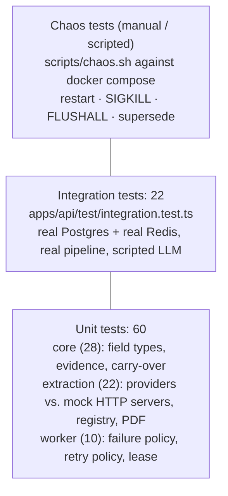

# Testing

How the system is verified, from pure unit tests up to killing containers. The goal is to show, with a repeatable command, every behaviour the brief says will be tested: instant upload, restart and kill recovery, Redis `FLUSHALL`, idempotency, failure as a state, and a new version arriving mid-extraction.

ARCHITECTURE.md explains *why* each of these holds. This document explains *how to check* that it does.

---

## 1. Test pyramid



| Layer | What is real | What is faked | Runs in |
|---|---|---|---|
| Unit | Pure functions, provider SDKs against a local HTTP server | The network (mock servers on `127.0.0.1`), timers (vitest fake timers) | < 2s, no services |
| Integration | Postgres, Redis/BullMQ, Fastify (`app.inject`), the worker pipeline, the PDF parser, the fixture PDFs | The LLM only (`ScriptedExtractor`) | ~5s, needs Postgres and Redis |
| Chaos | The whole `docker compose` stack | The LLM (`LLM_PROVIDER=fake` with a delay) or a real key | Minutes, needs Docker |

The integration tests drive the **same `processVersion` and `reconcileOnce`** that the worker container runs. Only the LLM is replaced, so they test the real coordination logic, not a model of it.

---

## 2. How to run

```bash
pnpm install

# Unit tests, lint, types, dead code (no services needed)
pnpm knip
pnpm turbo run lint typecheck build test

# Integration tests (need Postgres + Redis)
docker run -d --name pg -p 5432:5432 -e POSTGRES_HOST_AUTH_METHOD=trust -e POSTGRES_DB=lomi_test postgres:16-alpine
docker run -d --name redis -p 6379:6379 redis:7-alpine
DATABASE_URL=postgres://postgres@localhost:5432/lomi_test REDIS_URL=redis://localhost:6379/1 \
  pnpm turbo run test:integration

# Chaos tests (whole stack)
LLM_PROVIDER=fake FAKE_LLM_DELAY_MS=8000 docker compose up -d --build
scripts/chaos.sh            # or: restart | kill | flush | supersede
docker compose down -v
```

CI (`.github/workflows/ci.yml`) runs knip, lint, typecheck, build, unit and integration tests with Postgres and Redis service containers, and builds the Docker images on every push.

The integration tests migrate the database themselves and truncate all tables before each test, so every test is independent and order does not matter.

---

## 3. Reliability matrix: brief requirement → proof

Each row names the automated test that proves the behaviour, and the chaos scenario that shows it on the real stack.

| # | Requirement | Automated test (`integration.test.ts` unless noted) | Chaos scenario | Expected result |
|---|---|---|---|---|
| R1 | Upload returns instantly, never waits for the LLM | `responds immediately with queued, without touching the LLM` | Any upload in `chaos.sh` | `202` with `status: queued` in < 1s |
| R2 | Upload works while Redis is down | `still accepts the upload when Redis is down (reconciler enqueues it later)` | `docker compose stop redis`, upload, `start redis` | Upload `202`; extracted within ~10s of Redis returning |
| R3 | `docker compose restart` mid-extraction | `graceful shutdown hands the in-flight run back without spending an attempt` | `chaos.sh restart` | Ends `extracted`; run log shows an `abandoned` run, then a `succeeded` one; attempts not inflated |
| R4 | Worker killed (`SIGKILL`) mid-extraction | `a worker killed mid-extraction: lease expires, reconciler re-queues, next run completes` · `a restarted worker recovers its own orphaned runs immediately, without waiting for the lease` | `chaos.sh kill` | Ends `extracted` right after the worker restarts |
| R5 | Redis `FLUSHALL` | `FLUSHALL on Redis: the reconciler rebuilds the queue from Postgres` | `chaos.sh flush` | Every `queued` version is re-enqueued; nothing is lost |
| R6 | Idempotency: duplicate jobs, concurrent workers | `is idempotent: concurrent and repeated runs of one version store one set of values` | Scale workers: `docker compose up -d --scale worker=3` | Exactly one value per field; other claims are `not_claimed` |
| R7 | A late "zombie" cannot overwrite newer work | `the zombie worker that comes back late cannot commit over the new run` | n/a (timing too narrow by hand) | Zombie commit returns `lost ownership`; values come from the new run |
| R8 | Failure is a visible state, not a crash | `turns an LLM error into a visible failed state, and retry recovers it` · `marks an unparseable PDF as failed` | Run with no API key: `LLM_PROVIDER=gemini GEMINI_API_KEY= docker compose up` | Version `failed` with a readable error; **Retry** in the UI re-queues it |
| R9 | Poison document cannot loop forever | `gives up after max attempts so a poison document can't loop forever` | n/a | `failed` after `MAX_ATTEMPTS` (3) |
| R10 | Rate limits back off durably | `a rate limit re-queues with backoff (durably, in Postgres), then succeeds` · `gives up with a visible failure when the rate limit outlasts the attempt budget` · worker `retryDelayMs` / `classifyFailure` unit tests | Free-tier Gemini key, upload several docs | `queued` with `retry_at` and "Will retry: …"; not claimable before `retry_at`; survives restarts |
| R11 | New version mid-extraction | `a new version mid-extraction supersedes the running one; its late result is discarded` · `the heartbeat notices a supersede and aborts the LLM call early` | `chaos.sh supersede` | v2 `superseded`, v3 `extracted`; no v2 values |
| R12 | Same file uploaded twice | `uploading the same file twice does not create another version` | Upload the same PDF twice | Second upload `200`, `duplicate: true`, no new version |
| R13 | Hallucination defence | `stores a hallucinated quote as a gap, never as a value` · core: `turns a fabricated quote into a gap`, `turns a real quote with an invented value into a gap`, `never accepts evidence from another version's text` | n/a | Gap with a reason that quotes the rejected evidence |
| R14 | Carry-over only when truly unchanged | `revised invoice: exactly the two changed fields need review, the rest keep their reviews` · core: `flags exactly due_date and total_amount as changed`, `is independent of where the passage moved to`, `treats same value with a different passage as changed`, `never carries over gaps` | Review v1 in the UI, upload `invoice-001.v2.pdf` | 3 fields `carried_over`, 2 `pending` with a "changed" badge |
| R15 | Reviews only on the current version | `reviews on an older version are rejected once a new version exists` | Open an old version in the UI | Review buttons disabled; the API answers `409` |
| R16 | Corrections never overwrite the LLM value | `approves and corrects (correction kept beside the original value)` | Correct a value in the UI | Original and corrected value both visible |

---

## 4. Chaos procedures in detail

Start the stack with a slow fake LLM, so there is a wide window in which work is "mid-extraction":

```bash
LLM_PROVIDER=fake FAKE_LLM_DELAY_MS=8000 docker compose up -d --build
```

`scripts/chaos.sh` talks to `http://localhost:8080/api` (override with `API=`). For each scenario it uploads a document, waits about 1s so the version is `extracting`, causes the fault, then polls `/documents/:id/progress` until the status is `extracted` or `failed` (2 minutes at most).

### 4.1 Restart (`chaos.sh restart`)

1. Upload; the status is `extracting`.
2. `docker compose restart` sends `SIGTERM` to the worker. The worker aborts the in-flight LLM call and calls `releaseForShutdown`: the version goes back to `queued` with the attempt refunded, and the run is recorded as `abandoned`.
3. If Postgres stops first (the whole stack is restarting), the bounded shutdown gives up after 8s. On startup, `expireOrphanedLeases(worker_id)` finds the run still marked `running` under this worker's id and expires it at once.
4. **Expect:** `status: extracted`. In the UI's run log there is one `abandoned` run, then one `succeeded` run.

### 4.2 Kill (`chaos.sh kill`)

1. Upload; the status is `extracting`.
2. `docker compose kill -s SIGKILL worker`. No cleanup code runs.
3. `docker compose start worker`. The container keeps its hostname, so its `worker_id` matches, and orphan recovery re-queues the run immediately. A *different* worker would instead wait for the 30s lease to expire, which the reconciler checks every 10s.
4. **Expect:** `status: extracted`, attempts = 2.

### 4.3 FLUSHALL (`chaos.sh flush`)

1. Upload; the status is `extracting`.
2. `redis-cli FLUSHALL` wipes every job. Redis has no persistence in compose, so a restart would wipe it the same way.
3. `docker compose restart`.
4. **Expect:** `status: extracted`. The reconciler found the version in Postgres and enqueued it again.

To see the queue being rebuilt without a restart: flush, then watch `docker compose logs -f worker`. Within `RECONCILE_MS` (10s) the queued versions are enqueued again.

### 4.4 Supersede (`chaos.sh supersede`)

1. Upload `invoice-001.pdf` and wait for `extracted` (v1).
2. Upload `invoice-001.v2.pdf` (v2 starts extracting), then after 1s upload `invoice-001.pdf` again (v3).
3. **Expect:** the versions list shows `v1 extracted`, `v2 superseded`, `v3 extracted`. v2's run is marked `superseded`. Its heartbeat noticed the supersede and aborted the LLM call; if the call had finished anyway, the guarded commit would have discarded it.

### 4.5 Manual extras

| Scenario | Command | Expect |
|---|---|---|
| Redis down during upload | `docker compose stop redis` → upload in UI → `docker compose start redis` | Upload succeeds, extracted shortly after Redis is back |
| Postgres down | `docker compose stop postgres` | API returns 5xx (it is the system of record, so this is correct); the worker logs reconcile errors and recovers when Postgres returns |
| Many workers | `docker compose up -d --scale worker=3`, upload 10 docs | Every doc extracted once; `extraction_runs` shows one `succeeded` run per version |
| No API key | `LLM_PROVIDER=gemini` with no key | Every version `failed`: "GEMINI_API_KEY is not set…"; add the key, restart, press Retry |

Useful queries while experimenting:

```bash
docker compose exec postgres psql -U lomi lomi -c \
  "select v.version, v.status, v.attempts, v.retry_at, v.error from document_versions v order by created_at desc limit 10;"
docker compose exec postgres psql -U lomi lomi -c \
  "select version_id, attempt, status, worker_id, error from extraction_runs order by started_at desc limit 10;"
docker compose exec redis redis-cli keys 'bull:extraction:*'
```

---

## 5. Rate-limit testing

Rate limits are tested at three levels:

1. **Provider mapping (unit, `packages/extraction/test/*.test.ts`).** A local HTTP server plays Gemini or Groq and returns `429` with `retryDelay: "31s"` or a `Retry-After` header. The tests assert that the result is an `LlmError` with `retryable = true` and the right `afterMs`, and that a `400` is *not* retryable.
2. **Policy (unit, `apps/worker/test/policies.test.ts`).** `retryDelayMs` uses exponential backoff (20s, 40s, 80s), prefers the provider's hint and is capped at 5 minutes. `classifyFailure` gives the priority order: a lost lease beats shutdown, shutdown beats retry, and retry beats fail.
3. **Durability (integration).** After a `429` the version is `queued` with a future `retry_at`. `reconcile` does not return it and `claim` refuses it until the time passes (the test moves `retry_at` into the past). It then extracts normally. When every attempt is rate-limited, the version ends `failed` with "gave up after 3 attempts".

With a real free-tier key, upload more documents than the per-minute quota. The UI shows "Will retry: …" on the affected documents, and they complete without intervention as the quota frees up.

---

## 6. What a good run looks like

```
pnpm knip                                  → no output (no unused files, exports or deps)
pnpm turbo run lint typecheck build test   → 60 unit tests passed
pnpm turbo run test:integration            → 22 integration tests passed
scripts/chaos.sh                           → restart, kill, flush: "-> ...extracted..."
                                              supersede: v1 extracted, v2 superseded, v3 extracted
```

---

## 7. Known gaps

- **No real-LLM test in CI.** That would need a key, would cost money and would be flaky. Provider adapters are tested against recorded-shape mock servers, and Gemini was checked by hand with a real key.
- **No browser end-to-end tests** for the React UI. The UI is thin over the API, whose behaviour is covered by the integration tests. Playwright smoke tests (upload → review → re-upload) would be the next addition.
- **No load test.** README "At 10,000 documents" discusses the scaling plan. A k6 script against `/documents` with the fake LLM would be the first step.
- **Chaos scenarios are scripted, not in CI.** They need Docker-in-Docker and take minutes. CI does build the images, and the same recovery paths are covered by the integration tests.
